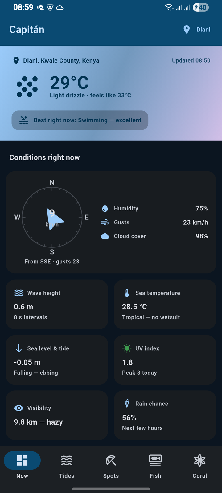
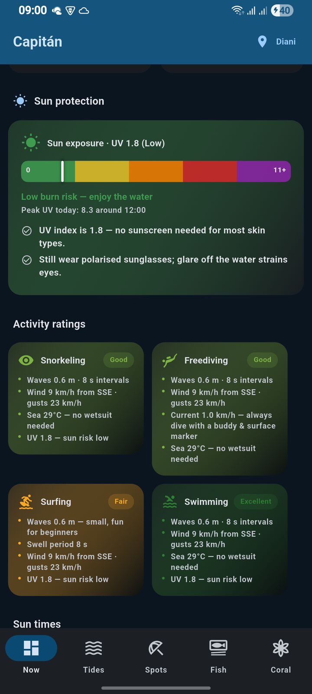
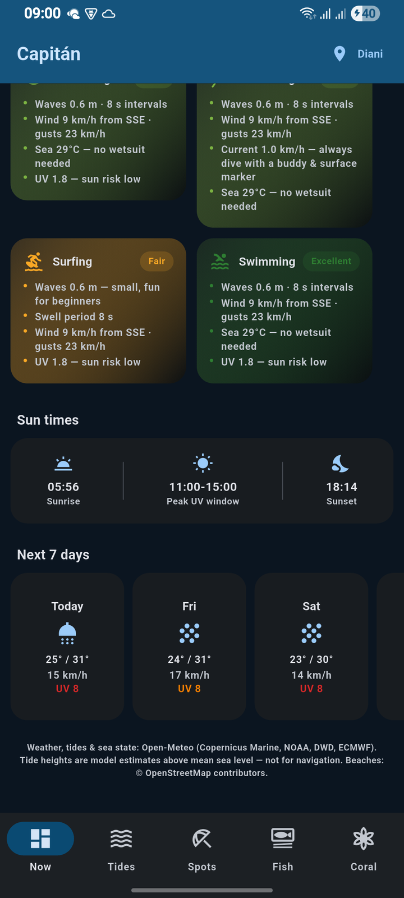
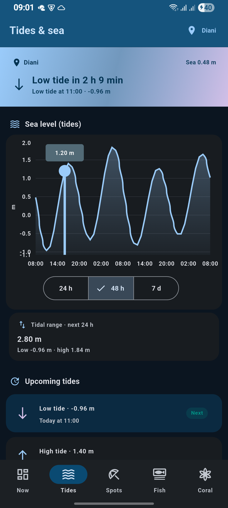
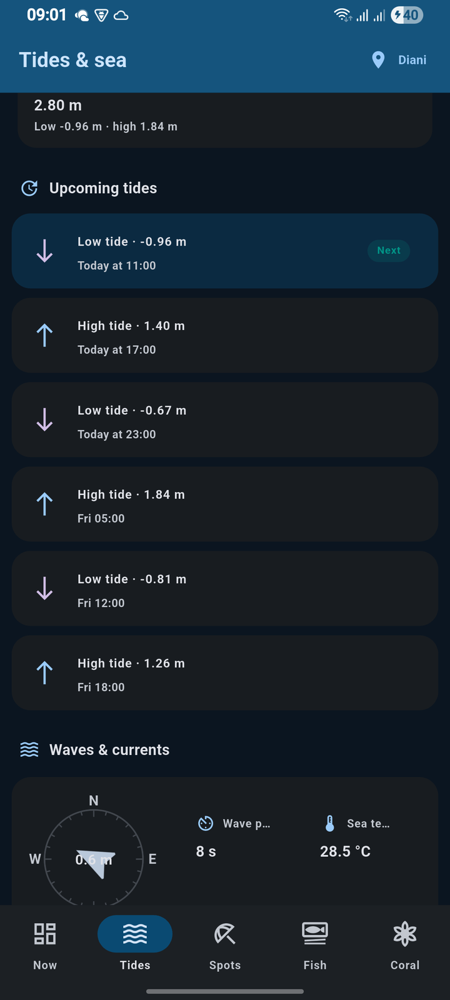
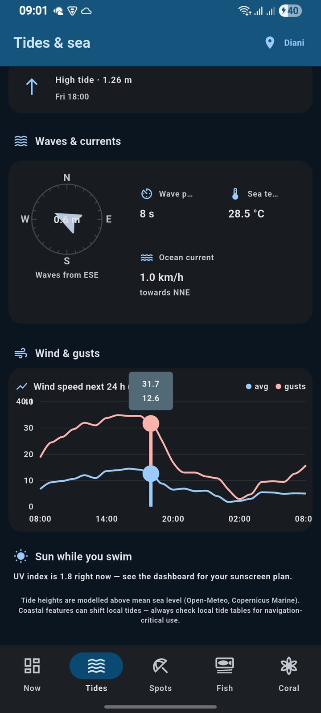
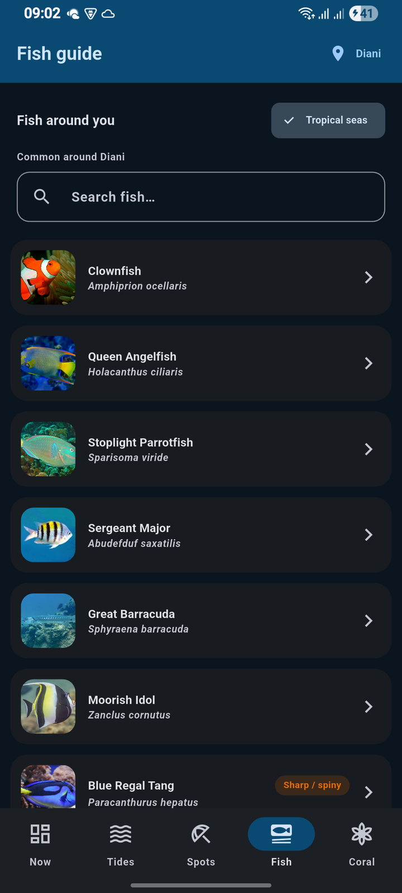
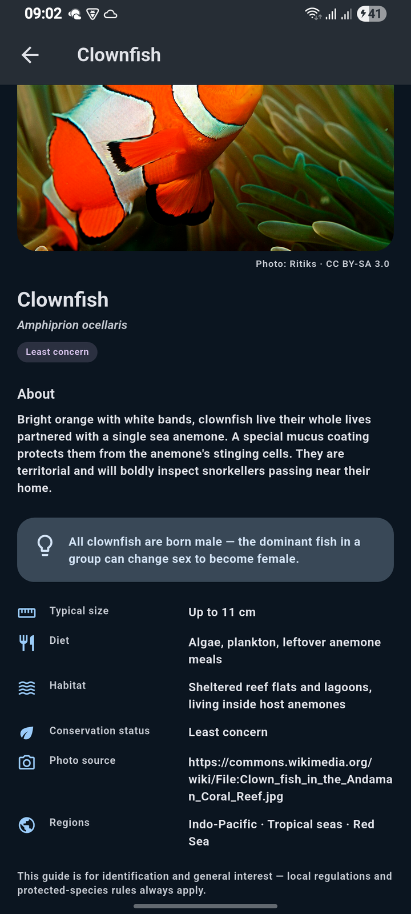
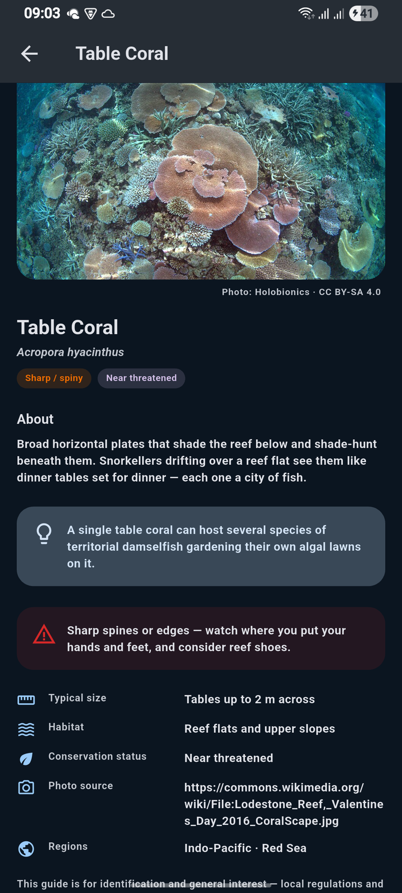
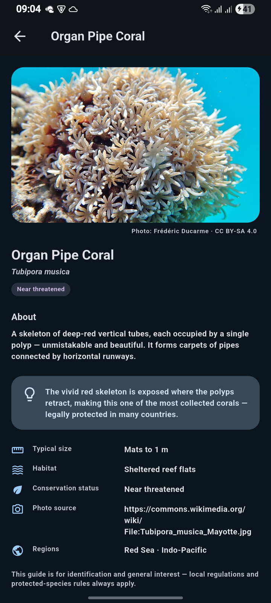

# Capitán

**Your pocket companion for the sea — conditions, tides, spots, and the reef life you meet.**

Capitán is a Flutter app for snorkellers, freedivers, surfers, and anyone who spends their free time in the water. It answers the questions I kept asking myself before and after every session:

- Is it worth getting in today? What will the wind, waves, and sea temperature feel like?
- When is the tide turning, and how much water is moving?
- Where did I swim last time — and what is that fish I just saw?
- What is safe to touch, and what should I keep my fins away from?
- How long can I stay out before the sun wins?

---

## Inspiration

I have been snorkelling and freediving for about a year now. Somewhere between the first nervous duck-dive and the first proper reef swim, the ocean went from "a nice place to visit" to the thing I plan my weekends around.

But a year in, I noticed something: I kept forgetting things.

I forgot the names of the dive spots I liked. I forgot which fish were harmless and which ones sting. I forgot whether the tide was coming in or going out, whether the wind would make the surface choppy by midday, and whether that bright coral was something I could gently point at — or something that would cut me if I brushed it.

Field guides are beautiful but heavy. Weather apps know the air temperature, not the sea. Tide tables are cryptic until you already understand tides. And none of them tell you, in one glance, *"today is a good day to snorkel here, but keep your hands to yourself."*

So I built Capitán: one small app that gathers the sea conditions, the tide, the local swim spots, and a photo guide to the fish and coral I am likely to see — with an opinionated, plain-language safety read on it all.

The goal is simple: spend less time guessing and more time in the water. And come home with all your fingers, a rough idea of what you saw, and a good story.

---

## What the app does

### Now — conditions and activity ratings
A single dashboard for the moment you are about to get in:

- Current air and "feels like" temperature, wind direction, gusts, humidity, and cloud cover.
- Wave height and period, sea-surface temperature, sea level, and whether the tide is rising, falling, or slacking.
- UV index now and today's peak, visibility, and rain chance for the next few hours.
- Sun protection advice that changes with the UV band (SPF, reapplication timing, rash-guard guidance, when to seek shade).
- Sunrise/sunset and a seven-day outlook.
- **Activity ratings for snorkelling, freediving, surfing, and swimming** — Excellent / Good / Fair / Poor / Dangerous, with the reasons behind each score: waves, wind, gusts, currents, sea temperature, and UV.
- **After dark, the app suggests rest instead of a water activity.** Capitán is a daylight companion; night swimming is a different sport with different risks.

### Tides & sea
- Sea-level chart for the next 24 hours, 48 hours, or 7 days.
- The next high or low tide, with time and height, plus the trend right now.
- Upcoming tide turns and the tidal range over the next 24 hours.
- Wave and current detail, plus an hourly wind and gust chart.
- A clear reminder that modelled tides are guidance, not navigation data.

### Spots — nearby swim spots
- Finds beaches and swimming areas around you using OpenStreetMap data (via Overpass).
- Shows distance, surface type, and — where the data exists — whether a spot is patrolled.
- Pulls weather and marine conditions for each spot and rates swimming there, so you can compare a few options before committing.
- One tap sets the spot as your current location, and Capitán remembers it next time.

### Fish guide
- 79 fish species, each with a photo, scientific name, size, diet, habitat, and conservation status.
- **Danger labels in plain language:** Harmless, Sharp / spiny, Stings, Venomous, Bites when provoked, Poisonous to eat.
- A short "what to know" description and a fun fact per species.
- Automatically filters to species typical for the waters around your current location (Caribbean, Indo-Pacific, Red Sea, Mediterranean, eastern Pacific, southern Australia, temperate waters, and more), with a toggle for the full guide and search by common or scientific name.

### Coral guide
- 58 corals and reef-life entries (including anemones, jellies, octopuses, turtles, sharks, clams, starfish, sponges and sea urchins), with photos and the same safety framing.
- Calls out fragile, sharp, and stinging reef life — the things to look at from a respectful distance rather than touch.
- Conservation status surfaced next to the danger label, because "don't touch" is both a safety rule and a reef rule.

### Anywhere you swim
- Search for a beach, town, or bay by name, or use your device location.
- Your chosen location is saved locally, so the app opens where you left off.

All species data and photos are bundled with the app — the fish and coral guides work offline.

---

## Screenshots

Captured on Android in Diani, Kenya.

| Now — conditions | Sun protection & activity ratings |
| --- | --- |
|  |  |

| Sun times & week ahead | Tides & sea |
| --- | --- |
|  |  |

| Upcoming tides & currents | Wind & sea detail |
| --- | --- |
|  |  |

| Fish guide | Clownfish |
| --- | --- |
|  |  |

| Table coral | Organ pipe coral |
| --- | --- |
|  |  |

---

## Safety, in plain terms

Capitán is a planning aid, not a lifeguard, a tide table, or a substitute for local knowledge.

- **Conditions are modelled.** Weather and marine forecasts can be wrong, especially close to shore and around headlands. Check the water with your own eyes before you commit.
- **Tides are estimates.** Tide heights are modelled above mean sea level (Open-Meteo / Copernicus Marine). Coastal features shift local tides; use official local tide tables for anything navigation-critical.
- **Ratings are heuristics.** The activity scores combine wind, waves, currents, water temperature, and UV. They do not know about your experience, your buddy, the exit, boat traffic, or the local shore break.
- **"Dangerous" means don't.** Thunderstorms, big surf, and strong currents push ratings to Dangerous. Treat that as a stop sign, not a challenge.
- **Look, don't touch.** The fish and coral guides flag sharp, stinging, venomous, biting, and poisonous species. Even "harmless" animals can be stressed or defended by reef rules and local law.
- **Go with a buddy, and go in daylight.** The app deliberately rates every activity as rest after dark.
- **Sun exposure is cumulative.** UV advice is per band, but reflections off the water mean you burn faster than the forecast suggests.

If you are ever unsure: don't get in. The sea will still be there tomorrow.

---

## Data sources and credits

| What | Source |
| --- | --- |
| Weather, forecast, geocoding | [Open-Meteo](https://open-meteo.com/) |
| Waves, sea level, sea temperature, currents | [Open-Meteo Marine API](https://open-meteo.com/en/docs/marine-weather-api) (Copernicus Marine data) |
| Beaches and swimming areas | [OpenStreetMap](https://www.openstreetmap.org/) via the [Overpass API](https://overpass-api.de/) |
| Species photos | [Wikimedia Commons](https://commons.wikimedia.org/) |
| Species reference summaries | [Wikipedia](https://en.wikipedia.org/) (development reference only) |

Photo licences are limited to public domain, CC0, CC BY, and CC BY-SA. Attribution is stored alongside each species and shown in the detail screen. Per-image credits are also kept in [`fish-credits.csv`](fish-credits.csv) and [`coral-credits.csv`](coral-credits.csv); please keep those files and the in-app attribution if you reuse the images.

---

## License

Capitán is free software, released under the [Apache License 2.0](LICENSE).

The species photographs in `assets/images/` are not covered by that licence. They are used under the public-domain, CC0, CC BY, or CC BY-SA licences recorded in [`fish-credits.csv`](fish-credits.csv) and [`coral-credits.csv`](coral-credits.csv), and attribution is shown in the app.
